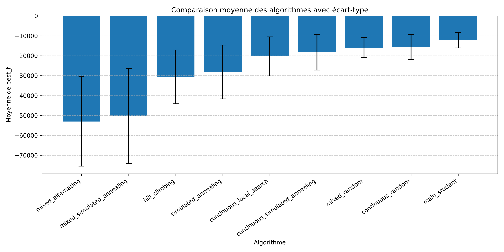

# Optimisation mixQUBO

Projet réalisé en **Master 1 Informatique à l’Université du Littoral Côte d’Opale**, durant l’année 2025–2026.

J’ai implémenté et comparé neuf méthodes d’optimisation pour un problème associant des variables binaires et continues. Le projet comprend les programmes C++, les scripts d’expérimentation et d’analyse, les résultats de 4 320 essais et le rapport.

**C++14 · CMake · Python · pandas · Matplotlib · Recherche locale · Recuit simulé**

[Énoncé du projet](docs/enonce.pdf) · [Rapport](docs/rapport.pdf) · [Sources du rapport](docs/rapport/main.tex) · [Résultats expérimentaux](results.csv)

## Le problème

Le problème mixQUBO étend l’optimisation quadratique binaire en introduisant des variables continues. L’objectif est de minimiser une fonction d’interactions entre :

- un vecteur binaire $x \in \{0,1\}^{n}$ ;
- un vecteur continu $z \in [-1,1]^{d}$.

Les expériences portent sur trois cas : l’optimisation binaire avec $z=0$, l’optimisation continue avec $x=0$, puis l’optimisation conjointe de $x$ et $z$. Les 16 instances comportent 100 ou 200 variables binaires, 10 ou 20 variables continues et entre 2 500 et 40 000 termes.

## Méthodes implémentées

| Cas | Méthode | Exécutable |
| --- | --- | --- |
| Binaire | Recherche aléatoire | `main_student` |
| Binaire | Recherche locale par inversion d’un bit, avec redémarrages | `hill_climbing` |
| Binaire | Recuit simulé | `simulated_annealing` |
| Continu | Recherche aléatoire | `continuous_random` |
| Continu | Recherche locale par perturbation gaussienne | `continuous_local_search` |
| Continu | Recuit simulé | `continuous_simulated_annealing` |
| Mixte | Recherche aléatoire | `mixed_random` |
| Mixte | Alternance entre recherche binaire et recherche continue | `mixed_alternating` |
| Mixte | Recuit simulé avec mouvements binaires et continus | `mixed_simulated_annealing` |

## Résultats

La campagne fournie comprend **9 méthodes × 16 instances × 30 exécutions = 4 320 essais**, avec un budget de **31 563 ms par essai**, calibré sur la machine utilisée pour le projet. Chaque ligne de `results.csv` contient la méthode, l’instance, le numéro de l’essai, la meilleure valeur trouvée, le nombre d’évaluations et le temps écoulé.

Dans ces résultats, `mixed_alternating` obtient la plus faible moyenne globale, devant `mixed_simulated_annealing`. La méthode alternée obtient également une meilleure moyenne que le recuit mixte sur **15 des 16 instances**. Une valeur plus faible correspond à une meilleure solution.



Le graphique regroupe des instances de tailles différentes : ses écarts-types incluent les différences entre instances et la variabilité des essais. Le script d’analyse affiche aussi les résultats par instance pour comparer les méthodes sur un même problème. Ces méthodes heuristiques ne garantissent pas l’optimum ; leurs tirages aléatoires et le budget temporel peuvent produire des valeurs différentes lors d’une nouvelle exécution.

## Compilation et premier lancement

Prérequis : un compilateur C++14, CMake 3.16 ou supérieur et Python 3 pour l’analyse. Le script d’expérimentation utilise Bash. RapidJSON est inclus dans les sources C++.

```bash
git clone https://github.com/DOUIMIAGH/optimisation-mixqubo.git
cd optimisation-mixqubo

cmake -S cpp -B cpp/build -DCMAKE_BUILD_TYPE=Release
cmake --build cpp/build --parallel

./cpp/build/src/test_mixQUBO instances/mxqubo_test.json
./cpp/build/src/mixed_alternating instances/mxqubo_v0_0.json 1000
```

Les neuf méthodes acceptent le chemin d’une instance et un budget en millisecondes. Elles affichent `best_f`, `nb_eval`, `time_ms` et la meilleure solution rencontrée.

### Étalonner le budget

```bash
./cpp/build/src/etalon instances/mxqubo_v0_15.json
```

L’étalon mesure le temps nécessaire à 30 000 évaluations sur la plus grande instance. L’énoncé indique 10 secondes sur la machine de référence et demande un budget équivalent à 15 secondes : utiliser **1,5 × le temps mesuré localement** comme budget. Les 31 563 ms des résultats fournis correspondent à l’étalonnage de la campagne initiale.

## Relancer les expériences

Depuis la racine du dépôt, un essai rapide sur les 16 instances :

```bash
RUNS=1 TIME_BUDGET_MS=50 OUT=results/verification.csv bash run_experiments.sh
```

Une campagne complète avec le budget initial :

```bash
RUNS=30 TIME_BUDGET_MS=31563 OUT=results/nouvelle_campagne.csv bash run_experiments.sh
```

Cette campagne représente environ **38 heures de calcul séquentiel**, hors chargement des fichiers. Pour un sous-ensemble, utiliser par exemple `INSTANCE_IDS="0 1"`. Par défaut, les nouvelles mesures sont enregistrées dans `results/latest.csv` ; le fichier historique `results.csv` est conservé.

## Analyser les données

```bash
python3 -m venv .venv
source .venv/bin/activate
python -m pip install -r requirements.txt

# Résultats de la campagne initiale
python analyze_results.py
python plot_results.py --output results/comparaison.png

# Résultats d’une nouvelle campagne
python analyze_results.py results/nouvelle_campagne.csv
python plot_results.py results/nouvelle_campagne.csv --output results/nouvelle_comparaison.png
```

Le graphique est sauvegardé sans ouvrir de fenêtre. Ajouter `--show` pour l’afficher dans un environnement graphique.

## Organisation du dépôt

| Chemin | Contenu |
| --- | --- |
| `cpp/src/` | Méthodes d’optimisation, évaluation de l’objectif et utilitaires |
| `python/` | Implémentation Python du problème et exemples pédagogiques |
| `instances/` | Instance de test, 16 instances d’expérimentation et valeurs connues |
| `run_experiments.sh` | Lancement des essais et export CSV |
| `analyze_results.py`, `plot_results.py` | Statistiques et visualisation |
| `results.csv`, `comparison_algorithms.png` | Résultats et graphique de la campagne initiale |
| `docs/` | Énoncé, rapport PDF et sources LaTeX du rapport |

## Auteur et cadre pédagogique

**Abdelmoughit Douimia** — Master 1 Informatique, ULCO, 2025–2026.

Le projet s’appuie sur le sujet, les instances et le socle pédagogique fournis par **Sébastien Verel**. Les mentions d’auteur et de licence des fichiers d’origine sont conservées. Les méthodes d’optimisation, leur comparaison expérimentale et le rapport constituent mon travail dans ce cadre universitaire.

La licence du dépôt est conservée dans [LICENSE](LICENSE). Les composants fournis conservent leurs notices propres, notamment RapidJSON sous licence MIT et les fichiers Python pédagogiques marqués CC-by.
